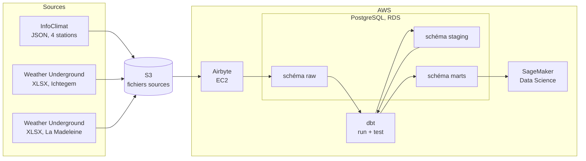

# Architecture globale

Ce document décrit l'architecture du pipeline Forecast 2.0, de la collecte des données
météo jusqu'à leur exploitation par les Data Scientists de GreenAndCoop.

## Vue d'ensemble

Le pipeline suit une logique ELT : les données sont d'abord chargées brutes dans
PostgreSQL, puis transformées directement dans la base avec dbt.

## Composants

| Composant | Rôle | Environnement local | Environnement AWS |
|---|---|---|---|
| Stockage des fichiers | dépôt des sources avant ingestion | dossier `data/` | bucket S3 |
| Airbyte | ingestion et synchronisation | abctl | EC2 |
| PostgreSQL | stockage de toutes les couches | Docker | RDS |
| dbt | transformation, tests, documentation | poste de travail | EC2 ou poste vers RDS |
| SageMaker | consommation par les Data Scientists | sans objet | connexion en lecture seule |

## Organisation de la base

Une seule base, trois schémas qui correspondent aux étapes du pipeline.

| Schéma | Contenu | Alimenté par |
|---|---|---|
| raw | données brutes telles que reçues, une table par source | Airbyte |
| staging | données nettoyées et typées, une vue ou table par source | dbt |
| marts | tables finales harmonisées pour la modélisation | dbt |

Les Data Scientists n'interrogent que le schéma `marts`.

### Modèle de données final (schéma marts)

- `dim_stations` : une ligne par station (identifiant, nom, réseau, commune, pays,
  latitude, longitude, altitude).
- `fact_mesures_meteo` : une ligne par station et par horodatage (température,
  humidité, pression, vent, précipitations, etc.), avec la clé étrangère vers
  `dim_stations` et la source d'origine.

Toutes les informations présentes dans les sources sont conservées. Les colonnes
spécifiques à un réseau restent disponibles, soit dans la table de faits, soit dans
une table annexe.

## Flux de données

1. Les fichiers sources sont déposés dans S3 (ou lus localement en développement).
2. Airbyte lit chaque source et charge les données brutes dans le schéma `raw`.
3. dbt construit les modèles `staging` : renommage, typage, conversion des unités
   (par exemple °F en °C, mph en km/h), normalisation des horodatages en UTC.
4. dbt construit les modèles `marts` en unifiant les trois sources.
5. dbt exécute les tests de qualité à chaque passage.
6. Les Data Scientists lisent `marts` depuis SageMaker.

Les fréquences de mesure diffèrent selon les stations (10, 15 ou 30 minutes). Elles
sont conservées telles quelles, sans rééchantillonnage dans la couche `marts`.

## Sécurité et accès

| Rôle PostgreSQL | Droits | Utilisé par |
|---|---|---|
| airbyte_writer | écriture sur `raw` | Airbyte |
| dbt_runner | lecture sur `raw`, écriture sur `staging` et `marts` | dbt |
| ds_reader | lecture seule sur `marts` | SageMaker et Data Scientists |

- L'instance RDS n'est pas exposée publiquement : l'accès passe par un security group
  limité aux ressources nécessaires.
- Les identifiants sont stockés dans des variables d'environnement ou un gestionnaire
  de secrets, jamais dans le dépôt.
- Les connexions utilisent TLS.

## Qualité des données

Les contrôles sont portés par dbt :

- tests génériques : `not_null`, `unique`, `accepted_values`, `relationships` ;
- tests de cohérence : plages plausibles pour la température, l'humidité, la pression,
  le vent ;
- détection des doublons sur (station, horodatage) ;
- suivi du taux d'erreurs, calculé comme le nombre de lignes en échec rapporté au
  nombre total de lignes, détaillé dans `docs/rapport_qualite.md`.

## Délai de mise à disposition

| Étape | Durée mesurée |
|---|---|
| synchronisation Airbyte | à compléter |
| `dbt run` | à compléter |
| `dbt test` | à compléter |
| total entre l'arrivée du fichier et la disponibilité dans `marts` | à compléter |

## Choix techniques et justifications

- Airbyte : recommandé par l'équipe, adapté aux sources hétérogènes, charge
  directement dans PostgreSQL.
- dbt : transformation versionnée en SQL, tests et documentation intégrés, lineage
  généré automatiquement.
- PostgreSQL sur RDS : imposé par la DSI (AWS) et directement accessible depuis
  SageMaker.
- Trois schémas : séparation nette entre données brutes, nettoyées et prêtes à
  l'usage, ce qui permet de rejouer les transformations sans recharger les sources.

## Points à trancher

- Où s'exécute dbt en production : sur l'instance EC2 d'Airbyte ou depuis un poste.
- Mode de déclenchement : manuel, planifié par Airbyte, ou orchestré par un script.
- Politique de rétention des données brutes dans `raw`.