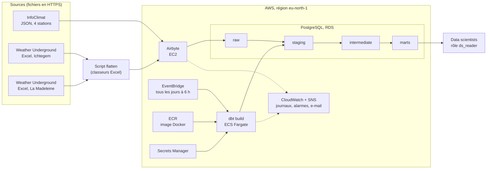

# Architecture globale

Ce document décrit l'architecture du pipeline Forecast 2.0, de la collecte des données météo jusqu'à leur exploitation par les data scientists de GreenAndCoop.

## Vue d'ensemble

Le pipeline suit une logique ELT : les données sont d'abord chargées brutes dans PostgreSQL, puis transformées directement dans la base avec dbt.

## Composants

| Composant | Rôle | Environnement local | Environnement AWS |
|---|---|---|---|
| Fichiers sources | données brutes à ingérer | fichiers lus en HTTPS | idem |
| Script `flatten_workbooks.py` | ajoute le nom d'onglet aux classeurs Excel | poste de travail | idem (étape préalable) |
| Airbyte | ingestion et synchronisation | `abctl` sur le poste | EC2 (`abctl`), accès par tunnel SSH |
| PostgreSQL | stockage de toutes les couches | Docker | RDS PostgreSQL 16 |
| dbt | transformation, tests, documentation | environnement Python sur le poste | image Docker exécutée par ECS Fargate |
| Planification | lancement quotidien de dbt | manuel | EventBridge Scheduler, tous les jours à 6 h (Europe/Paris) |
| Secrets | mots de passe de la base | variables d'environnement, fichier `.env` | Secrets Manager |
| Supervision | journaux, métriques, alertes | sans objet | CloudWatch et SNS (e-mail) |

## Organisation de la base

Une seule base (`meteo`), quatre schémas qui correspondent aux étapes du pipeline.

| Schéma | Contenu | Alimenté par |
|---|---|---|
| `raw` | données brutes telles que reçues, une table par source | Airbyte |
| `staging` | données nettoyées et typées, une vue par source, plus le seed des stations amateurs | dbt |
| `intermediate` | unités communes, heure en UTC, union des sources | dbt |
| `marts` | tables finales pour l'analyse | dbt |

Les data scientists n'interrogent que le schéma `marts`.

### Modèle de données final (schéma marts)

Schéma en étoile, avec une table de faits et deux dimensions :

- `dim_weather_stations` : une ligne par station (identifiant, nom, réseau, type, latitude, longitude, altitude, ville, pays, matériel).
- `dim_date` : une ligne par jour (date, année, mois, jour, nom du jour, indicateur de week-end).
- `fact_weather_measurements` : une ligne par station et par instant en UTC (température, point de rosée, humidité, pression, vent, rafales, précipitations, rayonnement, visibilité, etc.), avec les clés `station_id` et `date_key`.

Toutes les informations présentes dans les sources sont conservées. Les colonnes absentes d'une source restent à `NULL`, jamais à zéro.

## Flux de données

1. Les classeurs Excel passent par le script d'aplatissement, qui ajoute le nom de l'onglet (la date n'existe que dans ce nom).
2. Airbyte lit chaque fichier en HTTPS et charge les données brutes dans `raw`, en full refresh avec écrasement.
3. dbt construit les modèles `staging` : extraction du JSON, conversion du texte en nombres, identifiant et date des stations Weather Underground.
4. dbt construit les modèles `intermediate` : conversion des unités (°F en °C, pouces de mercure en hPa, mph en km/h, pouces en mm), heure de Paris convertie en UTC, union des sources.
5. dbt construit les tables `marts` et exécute les 15 tests de qualité (`dbt build`).
6. Les data scientists lisent `marts` avec le rôle `ds_reader`.

Les fréquences de mesure diffèrent selon les stations (environ 5 minutes pour Weather Underground, 10 minutes ou 1 heure pour InfoClimat). Elles sont conservées telles quelles, sans rééchantillonnage.

### Enchaînement entre Airbyte et dbt

La synchronisation Airbyte est manuelle (les fichiers sont figés). L'option « Drop tables with CASCADE » est activée, car les vues de `staging` dépendent des tables de `raw` ; elle supprime ces vues à chaque synchronisation. dbt doit donc être relancé après chaque synchronisation, ce que fait la tâche quotidienne de 6 h, ou une exécution à la demande.

## Sécurité et accès

| Mesure | Détail |
|---|---|
| Rôle `ds_reader` | lecture seule sur le schéma `marts`, aucun accès à `raw` |
| Droits par défaut | `alter default privileges` pour que les tables recréées par dbt restent lisibles |
| Secrets | mots de passe dans Secrets Manager, injectés à l'exécution dans la tâche dbt ; jamais dans le dépôt ni dans l'image |
| Rôle d'exécution ECS | limité à la lecture des secrets de la tâche |
| Réseau | un groupe de sécurité par composant (RDS, instance Airbyte, tâche dbt) |
| Interface d'Airbyte | non exposée sur Internet, accessible par tunnel SSH |
| Chiffrement | disque de RDS chiffré, connexions de dbt en `sslmode: require` |
| Compte AWS | authentification multifacteur sur le compte racine |

## Qualité des données

Les contrôles sont portés par dbt, avec 15 tests exécutés à chaque `dbt build` :

- 12 tests génériques (`not_null`, `unique`, `accepted_values`, `relationships`) ;
- 3 tests personnalisés : unicité du grain (station, instant), humidité entre 0 et 100 %, température entre -30 et 50 °C.

Indicateurs relevés sur la base :

| Indicateur | Valeur |
|---|---|
| Mesures dans la table de faits | 4950 |
| Doublons sur (station, instant) | 0 |
| Mesures sans station ou sans date | 0 |
| Lignes vides par fichier Weather Underground | 7, écartées en `staging` |
| Complétude Weather Underground | environ 94 % (1899 et 1908 relevés pour 2016 attendus) |
| Rafales des stations InfoClimat de type `static` | toujours vides |

## Délai de mise à disposition

| Étape | Durée mesurée |
|---|---|
| Synchronisation Airbyte (1915 lignes, AWS) | 26 s |
| `dbt build` sur ECS Fargate (25 étapes) | 2,21 s |
| Exécution complète de la tâche Fargate, démarrage compris | environ 20 s |

Le même `dbt build` dure 0,64 s en local et 7,6 s depuis un poste de travail vers RDS : la latence réseau domine.

## Supervision

- Journaux : `/airbyte/meteo` (Airbyte) et `/ecs/meteo-dbt` (dbt), dans CloudWatch.
- Métriques : mémoire, swap et disque de l'instance Airbyte ; CPU et mémoire de la tâche dbt (Container Insights).
- Alarmes : CPU de RDS, espace disque de RDS inférieur à 2 Go, disque d'Airbyte supérieur à 85 %.
- Alerte par e-mail (SNS) si la tâche dbt s'arrête avec un code de sortie différent de 0.

## Choix techniques

- **Airbyte** : adapté aux sources hétérogènes, charge directement dans PostgreSQL.
- **dbt** : transformation versionnée en SQL, tests et documentation intégrés, graphe de dépendances généré automatiquement.
- **PostgreSQL sur RDS** : base managée, directement accessible depuis les outils de data science.
- **Quatre schémas** : séparation entre données brutes, nettoyées, unifiées et prêtes à l'usage, ce qui permet de rejouer les transformations sans recharger les sources.
- **dbt dans une image Docker sur Fargate** : même version en local et sur AWS, aucun serveur à gérer pour une tâche de quelques secondes par jour.

## Limites connues

- RDS est en zone unique, avec une sauvegarde automatique conservée 1 jour.
- L'instance RDS est joignable depuis Internet, protégée par un groupe de sécurité et un mot de passe.
- Il n'y a pas de clés étrangères en base, car dbt recrée les tables : l'intégrité est vérifiée par des tests `relationships`.
- dbt et Airbyte utilisent le compte d'administration de la base ; seul `ds_reader` est un compte dédié.
- Les deux réseaux n'ont que trois jours en commun (du 5 au 7 octobre).

## Pistes d'amélioration

- Déclencher dbt automatiquement à la fin d'une synchronisation Airbyte.
- Restreindre l'accès à RDS au réseau privé.
- Créer des comptes dédiés pour Airbyte et pour dbt.
- Planifier des snapshots de la base, avec une rétention plus longue.
- Définir une politique de rétention des données brutes dans `raw`.